<!-- 31337/tcp stage 1: UG9ydCAzMTMzNyBhbnN3ZXJlZC4gUmVhZCB0aGUgc291cmNlIG9mIGFzc2V0cy9oZXJvLnN2Zy4gSGV4LCBYT1IsIGFuZCB0aGUga2V5IGlzIHRoZSBzZXJ2aWNlIG5hbWUgb24gcG9ydCAxODgzLg== -->

<a href="https://github.com/Khanh1916#gh-light-mode-only">
  <picture>
    <source media="(max-width: 600px)" srcset="https://raw.githubusercontent.com/Khanh1916/Khanh1916/main/assets/hero-compact-light.svg">
    
  </picture>
</a>
<a href="https://github.com/Khanh1916#gh-dark-mode-only">
  <picture>
    <source media="(max-width: 600px)" srcset="https://raw.githubusercontent.com/Khanh1916/Khanh1916/main/assets/hero-compact.svg">
    
  </picture>
</a>

<p align="center">
  <a href="mailto:southkhanh@gmail.com?subject=Hello%20from%20GitHub&amp;x=#gh-light-mode-only"></a>
  <a href="mailto:southkhanh@gmail.com?subject=Hello%20from%20GitHub&amp;x=#gh-dark-mode-only"></a>
  <a href="https://www.facebook.com/n72khanh#gh-light-mode-only"></a>
  <a href="https://www.facebook.com/n72khanh#gh-dark-mode-only"></a>
  <a href="https://github.com/sponsors/Khanh1916#gh-light-mode-only"></a>
  <a href="https://github.com/sponsors/Khanh1916#gh-dark-mode-only"></a>
</p>

### `$ whoami`

I attack systems to learn how they fail, then build the tools that stop it happening again. Lately I've been stuck on a harder question: **how do you train an intrusion detector on traffic nobody is allowed to see?**

You're the pentester now. Here's what the scan found.

### `$ nmap`

<a href="https://github.com/Khanh1916#gh-light-mode-only">
<picture>
  <source media="(max-width: 600px)" srcset="https://raw.githubusercontent.com/Khanh1916/Khanh1916/main/assets/nmap-compact-light.svg">
  
</picture>
</a>
<a href="https://github.com/Khanh1916#gh-dark-mode-only">
<picture>
  <source media="(max-width: 600px)" srcset="https://raw.githubusercontent.com/Khanh1916/Khanh1916/main/assets/nmap-compact.svg">
  
</picture>
</a>

<details>
<summary>Open the rack: full stack</summary>
<br/>

<a href="https://github.com/Khanh1916#gh-light-mode-only">
<picture>
  <source media="(max-width: 600px)" srcset="https://raw.githubusercontent.com/Khanh1916/Khanh1916/main/assets/stack-compact-light.svg">
  
</picture>
</a>
<a href="https://github.com/Khanh1916#gh-dark-mode-only">
<picture>
  <source media="(max-width: 600px)" srcset="https://raw.githubusercontent.com/Khanh1916/Khanh1916/main/assets/stack-compact.svg">
  
</picture>
</a>

</details>

### `$ cat findings.md`

<!-- findings:start -->

<p align="center">
  <a href="https://github.com/Khanh1916/oracle-sec-lab#gh-light-mode-only"></a>
  <a href="https://github.com/Khanh1916/oracle-sec-lab#gh-dark-mode-only"></a>
  <a href="https://github.com/Khanh1916/secbaseline#gh-light-mode-only"></a>
  <a href="https://github.com/Khanh1916/secbaseline#gh-dark-mode-only"></a>
  <a href="https://github.com/Khanh1916/PP-FedData#gh-light-mode-only"></a>
  <a href="https://github.com/Khanh1916/PP-FedData#gh-dark-mode-only"></a>
  <a href="https://github.com/Khanh1916/viet-skill#gh-light-mode-only"></a>
  <a href="https://github.com/Khanh1916/viet-skill#gh-dark-mode-only"></a>
</p>

<!-- findings:end -->

### `$ tcpdump`

<a href="https://github.com/Khanh1916#gh-light-mode-only"></a>
<a href="https://github.com/Khanh1916#gh-dark-mode-only"></a>

### `$ nc khanh1916 31337`

<details>
<summary><b>The scan flagged one filtered port. There is a real flag hidden in this profile.</b></summary>
<br/>

No guessing and no brute force. A browser is enough.

1. Read this page the way a browser doesn't.
2. Whatever you find there will send you somewhere else. The scan above has the last piece.

Check your answer locally, so nobody has to see it:

```bash
echo -n 'flag{...}' | sha256sum
# b83a1eafdd4db16c84ffdec5f733d35f4a43a31df18a928cf728bceab8ebcd80
```

Got it? [Tell me how you solved it.](mailto:southkhanh@gmail.com?subject=31337%20solved)

</details>

### `$ ./support`

If my labs or tools helped you learn or build something, you can support me. Thank you!

- **International:** [GitHub Sponsors](https://github.com/sponsors/Khanh1916) is preferred. [Ko-fi](https://ko-fi.com/khanh1916) also works if you'd rather pay by card or PayPal without a GitHub account.
- **Vietnam:** [MoMo](https://me.momo.vn/j8I5TbsbtxizUqtafoIKiv) is preferred.

<p align="center">
  <a href="https://github.com/sponsors/Khanh1916#gh-light-mode-only"></a>
  <a href="https://github.com/sponsors/Khanh1916#gh-dark-mode-only"></a>
  <a href="https://ko-fi.com/khanh1916#gh-light-mode-only"></a>
  <a href="https://ko-fi.com/khanh1916#gh-dark-mode-only"></a>
  <a href="https://me.momo.vn/j8I5TbsbtxizUqtafoIKiv#gh-light-mode-only"></a>
  <a href="https://me.momo.vn/j8I5TbsbtxizUqtafoIKiv#gh-dark-mode-only"></a>
</p>

<a href="https://github.com/Khanh1916#gh-light-mode-only"></a>
<a href="https://github.com/Khanh1916#gh-dark-mode-only"></a>
