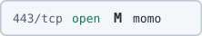

<!-- 31337/tcp stage 1: UG9ydCAzMTMzNyBhbnN3ZXJlZC4gUmVhZCB0aGUgc291cmNlIG9mIGFzc2V0cy9oZXJvLnN2Zy4gSGV4LCBYT1IsIGFuZCB0aGUga2V5IGlzIHRoZSBzZXJ2aWNlIG5hbWUgb24gcG9ydCAxODgzLg== -->

<p>
<picture>
  <source media="(prefers-color-scheme: dark) and (max-width: 600px)" srcset="https://raw.githubusercontent.com/Khanh1916/Khanh1916/main/assets/hero-compact.svg">
  <source media="(max-width: 600px)" srcset="https://raw.githubusercontent.com/Khanh1916/Khanh1916/main/assets/hero-compact-light.svg">
  <source media="(prefers-color-scheme: dark)" srcset="https://raw.githubusercontent.com/Khanh1916/Khanh1916/main/assets/hero.svg">
  
</picture>
</p>

<p align="center">
  <a href="mailto:southkhanh@gmail.com?subject=Hello%20from%20GitHub"><picture>
    <source media="(prefers-color-scheme: dark)" srcset="https://raw.githubusercontent.com/Khanh1916/Khanh1916/main/assets/btn-email.svg">
    
  </picture></a>
  <a href="https://www.facebook.com/n72khanh"><picture>
    <source media="(prefers-color-scheme: dark)" srcset="https://raw.githubusercontent.com/Khanh1916/Khanh1916/main/assets/btn-facebook.svg">
    
  </picture></a>
  <a href="https://github.com/sponsors/Khanh1916"><picture>
    <source media="(prefers-color-scheme: dark)" srcset="https://raw.githubusercontent.com/Khanh1916/Khanh1916/main/assets/btn-sponsor.svg">
    
  </picture></a>
</p>

<p>
<picture>
  <source media="(prefers-color-scheme: dark) and (max-width: 600px)" srcset="https://raw.githubusercontent.com/Khanh1916/Khanh1916/main/assets/session-compact.svg">
  <source media="(max-width: 600px)" srcset="https://raw.githubusercontent.com/Khanh1916/Khanh1916/main/assets/session-compact-light.svg">
  <source media="(prefers-color-scheme: dark)" srcset="https://raw.githubusercontent.com/Khanh1916/Khanh1916/main/assets/session.svg">
  
</picture>
</p>

<p>
<picture>
  <source media="(prefers-color-scheme: dark) and (max-width: 600px)" srcset="https://raw.githubusercontent.com/Khanh1916/Khanh1916/main/assets/nuclei-compact.svg">
  <source media="(max-width: 600px)" srcset="https://raw.githubusercontent.com/Khanh1916/Khanh1916/main/assets/nuclei-compact-light.svg">
  <source media="(prefers-color-scheme: dark)" srcset="https://raw.githubusercontent.com/Khanh1916/Khanh1916/main/assets/nuclei.svg">
  
</picture>
</p>

<!-- findings:start -->

<p align="center">
  <a href="https://github.com/Khanh1916/oracle-sec-lab"><picture>
    <source media="(prefers-color-scheme: dark)" srcset="https://raw.githubusercontent.com/Khanh1916/Khanh1916/main/assets/card-oracle-sec-lab.svg">
    
  </picture></a>
  <a href="https://github.com/Khanh1916/secbaseline"><picture>
    <source media="(prefers-color-scheme: dark)" srcset="https://raw.githubusercontent.com/Khanh1916/Khanh1916/main/assets/card-secbaseline.svg">
    
  </picture></a>
  <a href="https://github.com/Khanh1916/PP-FedData"><picture>
    <source media="(prefers-color-scheme: dark)" srcset="https://raw.githubusercontent.com/Khanh1916/Khanh1916/main/assets/card-pp-feddata.svg">
    
  </picture></a>
</p>

<!-- findings:end -->

<p>
<picture>
  <source media="(prefers-color-scheme: dark) and (max-width: 600px)" srcset="https://raw.githubusercontent.com/Khanh1916/Khanh1916/main/assets/activity-compact.svg">
  <source media="(max-width: 600px)" srcset="https://raw.githubusercontent.com/Khanh1916/Khanh1916/main/assets/activity-compact-light.svg">
  <source media="(prefers-color-scheme: dark)" srcset="https://raw.githubusercontent.com/Khanh1916/Khanh1916/main/assets/activity.svg">
  
</picture>
</p>

<details>
<summary><code>$ nc khanh1916 31337  # one filtered port, one real flag</code></summary>

```text
(UNKNOWN) [khanh1916] 31337 (?) open
There is a real flag hidden in this profile.
No guessing and no brute force. A browser is enough.

hint 1: read this page the way a browser doesn't
hint 2: what you find sends you somewhere else; the scan has the last piece

check your answer locally, so nobody has to see it (python3, slow on purpose):
$ python3 -c "import hashlib,sys; print(hashlib.scrypt( \
    sys.argv[1].encode(), salt=b'f7d5ec3334921e7b', \
    n=32768, r=8, p=1, dklen=16, maxmem=67108864).hex())" 'flag{...}'
8ce27edd7fbfb890a66adc4dde752dd8

solved it? write to southkhanh@gmail.com, subject: 31337
```

</details>

<p>
<picture>
  <source media="(prefers-color-scheme: dark) and (max-width: 600px)" srcset="https://raw.githubusercontent.com/Khanh1916/Khanh1916/main/assets/support-compact.svg">
  <source media="(max-width: 600px)" srcset="https://raw.githubusercontent.com/Khanh1916/Khanh1916/main/assets/support-compact-light.svg">
  <source media="(prefers-color-scheme: dark)" srcset="https://raw.githubusercontent.com/Khanh1916/Khanh1916/main/assets/support.svg">
  
</picture>
</p>

<p align="center">
  <a href="https://github.com/sponsors/Khanh1916"><picture>
    <source media="(prefers-color-scheme: dark)" srcset="https://raw.githubusercontent.com/Khanh1916/Khanh1916/main/assets/btn-sponsor.svg">
    
  </picture></a>
  <a href="https://ko-fi.com/khanh1916"><picture>
    <source media="(prefers-color-scheme: dark)" srcset="https://raw.githubusercontent.com/Khanh1916/Khanh1916/main/assets/btn-kofi.svg">
    
  </picture></a>
  <a href="https://me.momo.vn/j8I5TbsbtxizUqtafoIKiv"><picture>
    <source media="(prefers-color-scheme: dark)" srcset="https://raw.githubusercontent.com/Khanh1916/Khanh1916/main/assets/btn-momo.svg">
    
  </picture></a>
</p>

<p>
<picture>
  <source media="(prefers-color-scheme: dark) and (max-width: 600px)" srcset="https://raw.githubusercontent.com/Khanh1916/Khanh1916/main/assets/signoff-compact.svg">
  <source media="(max-width: 600px)" srcset="https://raw.githubusercontent.com/Khanh1916/Khanh1916/main/assets/signoff-compact-light.svg">
  <source media="(prefers-color-scheme: dark)" srcset="https://raw.githubusercontent.com/Khanh1916/Khanh1916/main/assets/signoff.svg">
  
</picture>
</p>
