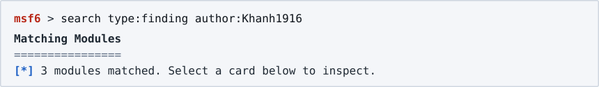

<!-- 31337/tcp stage 1: UG9ydCAzMTMzNyBhbnN3ZXJlZC4gUmVhZCB0aGUgc291cmNlIG9mIGFzc2V0cy9oZXJvLnN2Zy4gSGV4LCBYT1IsIGFuZCB0aGUga2V5IGlzIHRoZSBzZXJ2aWNlIG5hbWUgb24gcG9ydCAxODgzLg== -->

<picture>
  <source media="(prefers-color-scheme: dark) and (max-width: 600px)" srcset="https://raw.githubusercontent.com/Khanh1916/Khanh1916/main/assets/hero-compact.svg">
  <source media="(max-width: 600px)" srcset="https://raw.githubusercontent.com/Khanh1916/Khanh1916/main/assets/hero-compact-light.svg">
  <source media="(prefers-color-scheme: dark)" srcset="https://raw.githubusercontent.com/Khanh1916/Khanh1916/main/assets/hero.svg">
  
</picture>

<picture>
  <source media="(prefers-color-scheme: dark) and (max-width: 600px)" srcset="https://raw.githubusercontent.com/Khanh1916/Khanh1916/main/assets/nuclei-compact.svg">
  <source media="(max-width: 600px)" srcset="https://raw.githubusercontent.com/Khanh1916/Khanh1916/main/assets/nuclei-compact-light.svg">
  <source media="(prefers-color-scheme: dark)" srcset="https://raw.githubusercontent.com/Khanh1916/Khanh1916/main/assets/nuclei.svg">
  
</picture>

<!-- findings:start -->

<a href="https://github.com/Khanh1916/oracle-sec-lab"><picture><source media="(prefers-color-scheme: dark) and (max-width: 600px)" srcset="https://raw.githubusercontent.com/Khanh1916/Khanh1916/main/assets/card-oracle-sec-lab-compact.svg"><source media="(max-width: 600px)" srcset="https://raw.githubusercontent.com/Khanh1916/Khanh1916/main/assets/card-oracle-sec-lab-compact-light.svg"><source media="(prefers-color-scheme: dark)" srcset="https://raw.githubusercontent.com/Khanh1916/Khanh1916/main/assets/card-oracle-sec-lab.svg"></picture></a>

<a href="https://github.com/Khanh1916/secbaseline"><picture><source media="(prefers-color-scheme: dark) and (max-width: 600px)" srcset="https://raw.githubusercontent.com/Khanh1916/Khanh1916/main/assets/card-secbaseline-compact.svg"><source media="(max-width: 600px)" srcset="https://raw.githubusercontent.com/Khanh1916/Khanh1916/main/assets/card-secbaseline-compact-light.svg"><source media="(prefers-color-scheme: dark)" srcset="https://raw.githubusercontent.com/Khanh1916/Khanh1916/main/assets/card-secbaseline.svg"></picture></a>

<a href="https://github.com/Khanh1916/PP-FedData"><picture><source media="(prefers-color-scheme: dark) and (max-width: 600px)" srcset="https://raw.githubusercontent.com/Khanh1916/Khanh1916/main/assets/card-pp-feddata-compact.svg"><source media="(max-width: 600px)" srcset="https://raw.githubusercontent.com/Khanh1916/Khanh1916/main/assets/card-pp-feddata-compact-light.svg"><source media="(prefers-color-scheme: dark)" srcset="https://raw.githubusercontent.com/Khanh1916/Khanh1916/main/assets/card-pp-feddata.svg"></picture></a>

<!-- findings:end -->

<picture>
  <source media="(prefers-color-scheme: dark) and (max-width: 600px)" srcset="https://raw.githubusercontent.com/Khanh1916/Khanh1916/main/assets/activity-compact.svg">
  <source media="(max-width: 600px)" srcset="https://raw.githubusercontent.com/Khanh1916/Khanh1916/main/assets/activity-compact-light.svg">
  <source media="(prefers-color-scheme: dark)" srcset="https://raw.githubusercontent.com/Khanh1916/Khanh1916/main/assets/activity.svg">
  
</picture>

<picture>
  <source media="(prefers-color-scheme: dark) and (max-width: 600px)" srcset="https://raw.githubusercontent.com/Khanh1916/Khanh1916/main/assets/signoff-compact.svg">
  <source media="(max-width: 600px)" srcset="https://raw.githubusercontent.com/Khanh1916/Khanh1916/main/assets/signoff-compact-light.svg">
  <source media="(prefers-color-scheme: dark)" srcset="https://raw.githubusercontent.com/Khanh1916/Khanh1916/main/assets/signoff.svg">
  
</picture>

