<!-- 31337/tcp stage 1: UG9ydCAzMTMzNyBhbnN3ZXJlZC4gUmVhZCB0aGUgc291cmNlIG9mIGFzc2V0cy9oZXJvLnN2Zy4gSGV4LCBYT1IsIGFuZCB0aGUga2V5IGlzIHRoZSBzZXJ2aWNlIG5hbWUgb24gcG9ydCAxODgzLg== -->

<p>
<a href="https://github.com/Khanh1916#gh-light-mode-only">
<picture>
  <source media="(max-width: 600px)" srcset="https://raw.githubusercontent.com/Khanh1916/Khanh1916/main/assets/hero-compact-light.svg">
  
</picture>
</a>
<a href="https://github.com/Khanh1916#gh-dark-mode-only">
<picture>
  <source media="(max-width: 600px)" srcset="https://raw.githubusercontent.com/Khanh1916/Khanh1916/main/assets/hero-compact.svg">
  
</picture>
</a>
</p>

<p align="center">
  <a href="mailto:southkhanh@gmail.com?subject=Hello%20from%20GitHub&amp;x=#gh-light-mode-only"></a>
  <a href="mailto:southkhanh@gmail.com?subject=Hello%20from%20GitHub&amp;x=#gh-dark-mode-only"></a>
  <a href="https://www.facebook.com/n72khanh#gh-light-mode-only"></a>
  <a href="https://www.facebook.com/n72khanh#gh-dark-mode-only"></a>
  <a href="https://github.com/sponsors/Khanh1916#gh-light-mode-only"></a>
  <a href="https://github.com/sponsors/Khanh1916#gh-dark-mode-only"></a>
</p>

<p>
<a href="https://github.com/Khanh1916#gh-light-mode-only">
<picture>
  <source media="(max-width: 600px)" srcset="https://raw.githubusercontent.com/Khanh1916/Khanh1916/main/assets/session-compact-light.svg">
  
</picture>
</a>
<a href="https://github.com/Khanh1916#gh-dark-mode-only">
<picture>
  <source media="(max-width: 600px)" srcset="https://raw.githubusercontent.com/Khanh1916/Khanh1916/main/assets/session-compact.svg">
  
</picture>
</a>
</p>

<p>
<a href="https://github.com/Khanh1916#gh-light-mode-only">
<picture>
  <source media="(max-width: 600px)" srcset="https://raw.githubusercontent.com/Khanh1916/Khanh1916/main/assets/nuclei-compact-light.svg">
  
</picture>
</a>
<a href="https://github.com/Khanh1916#gh-dark-mode-only">
<picture>
  <source media="(max-width: 600px)" srcset="https://raw.githubusercontent.com/Khanh1916/Khanh1916/main/assets/nuclei-compact.svg">
  
</picture>
</a>
</p>

<!-- findings:start -->

<p align="center">
  <a href="https://github.com/Khanh1916/oracle-sec-lab#gh-light-mode-only"></a>
  <a href="https://github.com/Khanh1916/oracle-sec-lab#gh-dark-mode-only"></a>
  <a href="https://github.com/Khanh1916/secbaseline#gh-light-mode-only"></a>
  <a href="https://github.com/Khanh1916/secbaseline#gh-dark-mode-only"></a>
  <a href="https://github.com/Khanh1916/PP-FedData#gh-light-mode-only"></a>
  <a href="https://github.com/Khanh1916/PP-FedData#gh-dark-mode-only"></a>
  <a href="https://github.com/Khanh1916/viet-skill#gh-light-mode-only"></a>
  <a href="https://github.com/Khanh1916/viet-skill#gh-dark-mode-only"></a>
</p>

<!-- findings:end -->

<p>
<a href="https://github.com/Khanh1916#gh-light-mode-only">
<picture>
  <source media="(max-width: 600px)" srcset="https://raw.githubusercontent.com/Khanh1916/Khanh1916/main/assets/activity-compact-light.svg">
  
</picture>
</a>
<a href="https://github.com/Khanh1916#gh-dark-mode-only">
<picture>
  <source media="(max-width: 600px)" srcset="https://raw.githubusercontent.com/Khanh1916/Khanh1916/main/assets/activity-compact.svg">
  
</picture>
</a>
</p>

<details>
<summary><code>$ nc khanh1916 31337  # one filtered port, one real flag</code></summary>

```text
(UNKNOWN) [khanh1916] 31337 (?) open
There is a real flag hidden in this profile.
No guessing and no brute force. A browser is enough.

hint 1: read this page the way a browser doesn't
hint 2: what you find sends you somewhere else; the scan has the last piece

check your answer locally, so nobody has to see it:
$ echo -n 'flag{...}' | sha256sum
b83a1eafdd4db16c84ffdec5f733d35f4a43a31df18a928cf728bceab8ebcd80  -

solved it? write to southkhanh@gmail.com, subject: 31337
```

</details>

<p>
<a href="https://github.com/Khanh1916#gh-light-mode-only">
<picture>
  <source media="(max-width: 600px)" srcset="https://raw.githubusercontent.com/Khanh1916/Khanh1916/main/assets/support-compact-light.svg">
  
</picture>
</a>
<a href="https://github.com/Khanh1916#gh-dark-mode-only">
<picture>
  <source media="(max-width: 600px)" srcset="https://raw.githubusercontent.com/Khanh1916/Khanh1916/main/assets/support-compact.svg">
  
</picture>
</a>
</p>

<p align="center">
  <a href="https://github.com/sponsors/Khanh1916#gh-light-mode-only"></a>
  <a href="https://github.com/sponsors/Khanh1916#gh-dark-mode-only"></a>
  <a href="https://ko-fi.com/khanh1916#gh-light-mode-only"></a>
  <a href="https://ko-fi.com/khanh1916#gh-dark-mode-only"></a>
  <a href="https://me.momo.vn/j8I5TbsbtxizUqtafoIKiv#gh-light-mode-only"></a>
  <a href="https://me.momo.vn/j8I5TbsbtxizUqtafoIKiv#gh-dark-mode-only"></a>
</p>

<p>
<a href="https://github.com/Khanh1916#gh-light-mode-only">
<picture>
  <source media="(max-width: 600px)" srcset="https://raw.githubusercontent.com/Khanh1916/Khanh1916/main/assets/signoff-compact-light.svg">
  
</picture>
</a>
<a href="https://github.com/Khanh1916#gh-dark-mode-only">
<picture>
  <source media="(max-width: 600px)" srcset="https://raw.githubusercontent.com/Khanh1916/Khanh1916/main/assets/signoff-compact.svg">
  
</picture>
</a>
</p>
